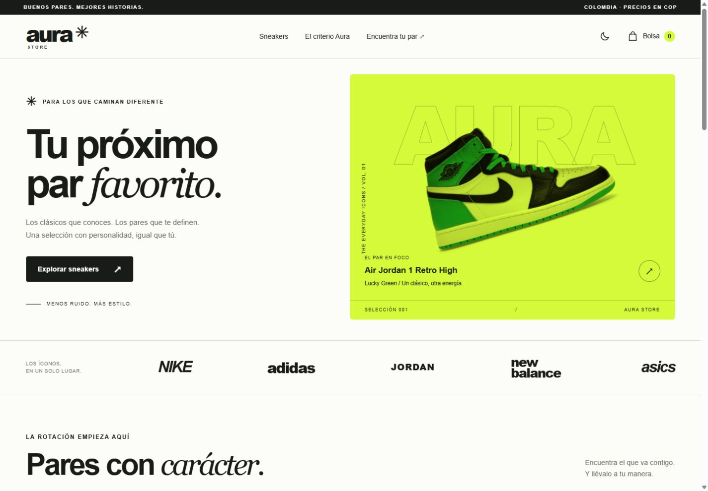
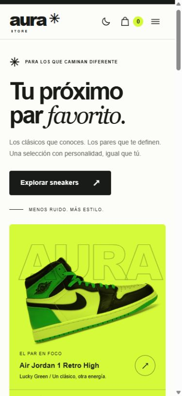

# Aura Store — sneakers con identidad

> **BASE PARA PERSONALIZAR.** Este documento fue preparado con asistencia de IA y todavía no cumple la exigencia de un README escrito en palabras propias. Antes de entregarlo, estudia [la guía técnica](docs/GUIA-TECNICA.md), reescribe las explicaciones y reemplaza todos los campos marcados. No inventes decisiones, dificultades ni cambios personales.

**Autor:** PENDIENTE — escribe tu nombre.  
**Curso:** Desarrollo Web · 2026-2 · Entrega 1.  
**Repositorio GitHub público:** PENDIENTE — pega la URL real después de publicar.  
**Sitio Vercel:** PENDIENTE — pega la URL pública real después de desplegar.

## El proyecto

Aura Store es una tienda académica de sneakers para personas en Colombia que quieren comparar una selección de modelos por marca, estilo y talla. Reúne seis pares en cinco marcas y tres categorías, con precios de demostración en COP. Busca hacer la elección más clara mostrando color, referencia, disponibilidad por talla y una descripción de estilo.

**PERSONALIZA:** reescribe el párrafo anterior, explica por qué elegiste sneakers y qué público concreto quieres atender. Confirma que el tema y contenido no coincidan con los de un compañero.

Es una simulación: no hay ventas, reservas, correos enviados ni cobros. Los precios y existencias son ficticios. Las fotografías son referencias de terceros; consulta los [créditos](docs/IMAGENES.md). No existe afiliación con las marcas mostradas.

## Qué puede hacer el visitante

- Explorar seis productos generados desde objetos JavaScript.
- Combinar categoría, marca y búsqueda; ordenar por precio o nombre.
- Consultar el detalle, elegir una talla disponible y añadirla a la bolsa.
- Modificar cantidades respetando stock; recuperar bolsa y tema al recargar.
- Preparar una solicitud con errores específicos junto a cada campo.
- Usar menú móvil, tema oscuro y navegación con teclado.

## Tecnologías y ejecución

HTML5, CSS3 y JavaScript ES Modules. Sin React, Bootstrap, Tailwind, jQuery ni otras dependencias de interfaz. Node se usa únicamente para desarrollo local y pruebas, no como backend de la tienda.

Con Node.js 22 o superior (verificado con 24.15.0):

```bash
node scripts/serve.cjs
```

Abre [Aura Store local](http://127.0.0.1:4173). Mantén esa terminal abierta. No abras `index.html` con doble clic: los módulos requieren un servidor HTTP. Alternativa: una extensión de servidor estático como Live Server. No hay instalación de paquetes ni paso de compilación para el sitio.

En otra terminal:

```bash
node --test tests/store.test.mjs
```

Resultado verificado: 12 pruebas aprobadas. El HTML pasó Nu/W3C sin errores ni advertencias. Consulta [evidencias y límites de las pruebas](docs/PRUEBAS.md).

## Estructura

```text
index.html
css/styles.css
js/
  data.js                 # productos, marcas y categorías
  store.js                # reglas puras de negocio
  app.js                  # DOM, eventos y persistencia
assets/images/            # fotografías locales y favicon
scripts/serve.cjs         # servidor local sin dependencias
tests/store.test.mjs      # pruebas con herramientas de Node
docs/
  PLAN.md                 # rúbrica, dominio y etapas de commits
  GUIA-TECNICA.md          # explicación para estudiar
  PUBLICACION.md          # GitHub y Vercel paso a paso
  AUDITORIA.md             # matriz y puntuación estimada
  PRUEBAS.md               # verificación observada
  IMAGENES.md              # procedencia de imágenes
  validacion-html.json     # respuesta de W3C
  capturas/               # capturas reales
.gitignore
```

## Modelo del dominio

Marcas y categorías tienen muchos productos mediante `brandId` y `categoryId`. Cada producto tiene tallas con stock. Un cliente puede tener varios pedidos; los detalles relacionan cada pedido con un producto, talla y cantidad. En esta entrega, los productos son fixtures locales y la solicitud solo construye un ejemplo de cliente/pedido en memoria. La bolsa se conserva sin datos personales.

**PERSONALIZA:** explica la diferencia entre «marca» y «categoría» usando Dunk y Samba. Describe qué parte cambiarías para consumir una API REST.

## Decisiones técnicas — reescribe en tus palabras

### Flexbox y Grid

Base factual: Flexbox alinea navegación, filtros y acciones. Grid distribuye hero, catálogo y formulario. El catálogo cambia entre una, dos y tres columnas según el ancho. Las variables CSS centralizan la paleta y permiten alternar el tema.

**TU PÁRRAFO:** ¿por qué un grupo de botones se adapta bien a Flexbox y las tarjetas a Grid? Cita clases concretas que hayas localizado.

### JavaScript y validación

Base factual: los eventos modifican filtros, renderizan tarjetas, abren el menú y el detalle, actualizan la bolsa y validan solicitudes. El formulario exige campos completos, email válido, longitudes correctas y talla con stock para el modelo elegido. Muestra mensajes junto al campo y no prepara la solicitud si hay errores.

**TU PÁRRAFO:** explica el recorrido desde un clic en «Elegir talla» hasta la bolsa. Después explica cómo se rechaza una solicitud inválida sin copiar código.

### Responsive y accesibilidad

Base factual: la interfaz se verificó a 320, 390, 768 y 1440 px, sin overflow horizontal. Incluye enlaces semánticos, etiquetas, alt descriptivos, focos visibles, estados ARIA, diálogos nativos y `prefers-reduced-motion`.

**TU PÁRRAFO:** describe un cambio de layout que hayas observado y una prueba que hayas hecho con teclado.

### Uso de inteligencia artificial

Registro honesto del trabajo asistido: la IA ayudó a traducir la rúbrica, diseñar la interfaz, escribir HTML/CSS/JS, estructurar datos, ejecutar pruebas, hacer commits, capturar pantallas y preparar esta documentación. La idea de Aura Store y las entidades de sneakers fueron propuestas por el estudiante. El desarrollo de los commits de esta sesión fue ejecutado por el asistente.

**TU PÁRRAFO:** explica qué entendiste, revisaste y cambiaste tú después. No afirmes que escribiste manualmente el código generado ni reduzcas el uso de IA a «solo ideas».

### Principal dificultad y solución

**PENDIENTE PERSONAL:** escribe una dificultad que hayas experimentado realmente. Indica el comportamiento observado, qué investigaste, qué cambiaste y cómo verificaste la solución. No hay una experiencia personal inventada aquí.

## Capturas reales

Estas capturas se tomaron durante las pruebas. Sustitúyelas si haces cambios visibles.

### Escritorio



### Móvil



También hay [captura de la página completa](docs/capturas/escritorio.png), [catálogo móvil](docs/capturas/catalogo-movil.png), [tablet](docs/capturas/tablet.png) y [modo oscuro](docs/capturas/oscuro.png).

## Git y publicación

Se construyó con etapas y commits reales. El plan se guardó antes del HTML en [PLAN.md](docs/PLAN.md). Los commits de esta sesión ocurrieron el mismo día: no se simularon fechas ni una distribución temporal que no existió. Revisa y continúa con cambios propios auténticos; no elimines ni recrees el historial.

Sigue [PUBLICACION.md](docs/PUBLICACION.md) para conectar GitHub público con Vercel, probar el redeploy y añadir las URLs. La publicación no se ha ejecutado desde este entorno. Consulta la [auditoría final](docs/AUDITORIA.md) antes de entregar.
