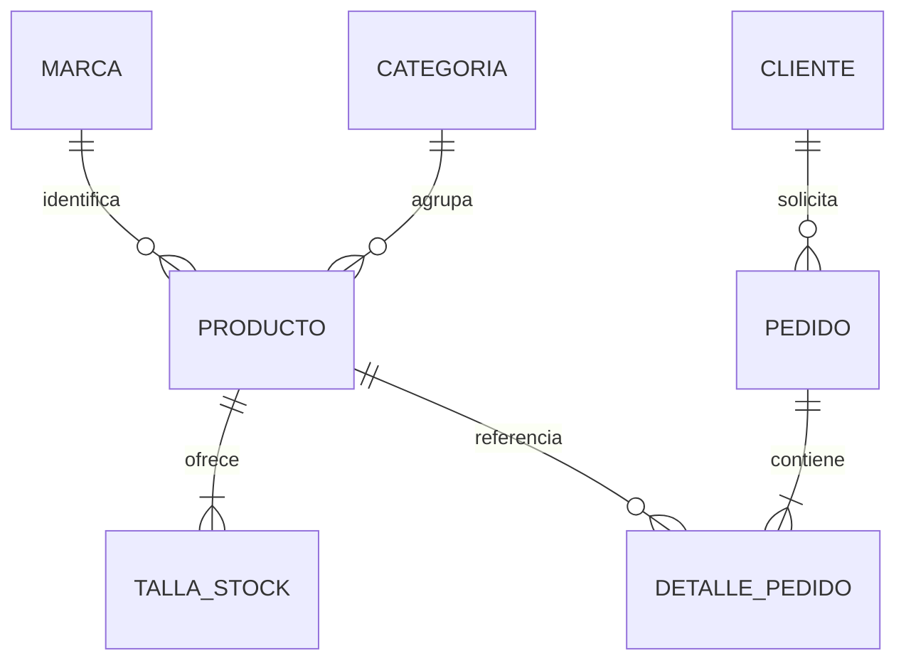

# Cómo entender y defender Aura Store

Lee esta explicación antes de reescribir el README. Es material de tutoría, no un relato de experiencias personales del estudiante.

## La decisión del proyecto

El estudiante propuso Aura Store, una tienda de sneakers, y las entidades productos, marcas, categorías, pedidos y clientes. La implementación convierte esa propuesta en un catálogo pequeño y comparativo: seis modelos, cinco marcas y tres categorías. La distinción entre marca y categoría importa: Nike identifica quién produce una silueta; «Court classics» explica el tipo de selección y puede contener varias marcas.

La propuesta de valor es elegir un próximo par por estilo y disponibilidad, sin perderse en miles de resultados. El público son personas en Colombia interesadas en moda urbana y sneakers. COP, tallas EU, colores específicos y stock por talla hacen que la lógica sea propia del dominio. Se eligió una solicitud de interés por modelo porque demuestra validación real sin fingir una pasarela de pago. La bolsa permite comparar y conservar pares; consultar su primer par precarga la solicitud, que siempre corresponde a una unidad de un modelo.

## Qué resuelve cada archivo

| Archivo | Responsabilidad |
| --- | --- |
| `index.html` | Contenido permanente, navegación, puntos de montaje y formulario. |
| `css/styles.css` | Identidad, tokens, Flexbox, Grid, estados, diálogos y media queries. |
| `js/data.js` | Datos de demostración relacionados mediante IDs y función `getCatalog`. |
| `js/store.js` | Filtros, stock, limpieza de bolsa, cantidades, subtotal y validación. No toca el DOM. |
| `js/app.js` | Conecta datos y reglas con botones, entradas, mensajes y renderizado. |
| `scripts/serve.cjs` | Servidor local para servir módulos por HTTP; no forma parte del backend del negocio. |
| `tests/store.test.mjs` | Ejemplos ejecutables de reglas válidas, inválidas y límites. |

## HTML y accesibilidad

`header` contiene la identidad y navegación; `nav` agrupa enlaces internos reales; `main` contiene las secciones de contenido; `section` tiene título; `article` identifica cada producto; `footer` incluye autoría comercial ficticia y créditos. Un `div` sigue siendo útil cuando solo agrupa elementos para un layout, sin inventar una sección semántica.

Solo existe un `h1`: «Tu próximo par favorito». Los títulos principales son `h2`; tarjetas, principios y formulario usan `h3`. El título del detalle se crea como `h2` dentro de un diálogo con nombre accesible. Existe también un título inicial para que `aria-labelledby` resuelva incluso antes de ejecutar JS.

Cada entrada tiene `label` relacionado por `for`/`id`. `aria-describedby` conecta instrucciones y errores; `aria-invalid` aparece únicamente si el valor es inválido. El menú usa `aria-controls` y `aria-expanded`; el tema y los filtros usan `aria-pressed`. Son estados comunicados al usuario, no propiedades decorativas.

Los diálogos nativos se abren con `showModal()`, permiten Escape, mantienen el foco dentro de la superficie modal y lo devuelven al disparador. El código conserva foco tras actualizar cantidades de la bolsa. El enlace «Saltar al contenido» permite evitar toda la navegación. `role="status"` anuncia resultados y confirmaciones sin usar `alert()`.

## Por qué Flexbox y Grid

Flexbox se usa en `.header-inner`, `.main-nav`, `.header-actions`, `.filter-chips`, `.brand-inner` y filas de acciones. Son conjuntos lineales: alinear logotipo, enlaces, botones o filtros, permitiendo envolver cuando falta espacio.

Grid se usa en `.hero`, `.product-grid`, `.manifesto-inner`, `.request-section` y `.form-row`. Estas áreas distribuyen columnas y permiten relacionar tamaños. El catálogo tiene tres columnas en escritorio, dos desde tablet hasta móvil habitual y una en pantallas de hasta 360 px. `minmax(0, 1fr)` permite encoger la columna sin que el contenido fuerce su ancho mínimo. Las consultas de medios también apilan el formulario y el hero, y habilitan el menú hamburguesa.

Las variables de `:root` centralizan fondo, texto, superficies y acento. Cambiar `data-theme` sustituye esas variables: no hacen falta dos hojas de estilo. Los colores de la foto conservan un fondo claro en las tarjetas oscuras. `mix-blend-mode: multiply` integra el fondo de las fotos en la superficie; el hero usa esa integración como tratamiento editorial, mientras el detalle muestra la referencia sobre fondo claro.

Las transiciones se limitan a controles, imágenes y avisos. `prefers-reduced-motion` las elimina y desactiva desplazamiento suave. No hay carruseles automáticos ni animaciones que interrumpan la lectura.

## Cómo funciona el JavaScript

1. `getCatalog()` entrega productos, marcas y categorías. El script es un módulo: el navegador lo carga después de analizar el HTML.
2. `renderProducts()` transforma cada producto en una tarjeta. Resuelve `brandId` y `categoryId` contra sus arreglos; formatea precios con `Intl.NumberFormat`.
3. Los eventos `input`, `change` y `click` actualizan un objeto de filtros. `filterProducts()` aplica las condiciones con AND y devuelve un arreglo nuevo. Buscar «PÁNDA» también encuentra «Panda» porque se normalizan acentos y mayúsculas.
4. Se vuelve a renderizar el catálogo y su contador. No se escribe una tarjeta diferente a mano para cada producto.
5. Un listener en el contenedor usa `closest('[data-product]')`: la delegación de eventos sigue funcionando aunque las tarjetas sean reemplazadas.

`escapeHTML()` evita interpretar los nombres y descripciones como etiquetas al insertarlos en una plantilla. El texto introducido por el visitante se muestra mediante `textContent`. En una futura API también habrá que validar URLs de imagen e IDs externos; el catálogo actual usa rutas e identificadores controlados localmente.

## Bolsa y reglas de talla

Una línea se identifica por **producto + talla**, no solo por producto. Dos Dunk talla 40 son una línea con cantidad 2; un Dunk talla 39 es otra. El stock pertenece a la talla. `changeBag()` rechaza una talla inexistente/agotada y no permite exceder la cantidad disponible. Restar hasta cero elimina la línea. `bagTotal()` consulta el precio del catálogo, sin fiarse de un precio guardado en la bolsa.

`localStorage` guarda solo referencias, tallas, cantidades y preferencia de tema. Las claves llevan `v1` para poder migrar su formato. `JSON.parse` y `JSON.stringify` convierten objetos a texto y viceversa. `normalizeBag()` limpia datos corruptos, productos eliminados, duplicados y cantidades superiores al stock. Si el navegador bloquea el almacenamiento, `try/catch` permite continuar en memoria y muestra un aviso.

La persistencia de una bolsa no significa reservar inventario. Este stock es una fixture académica; dos navegadores no comparten datos. Tampoco hay sincronización en vivo entre pestañas.

## Validación explicada sin copiar el código

El formulario usa `novalidate` para que la experiencia de error sea la definida en JS. Se conservan `required`, `type="email"` y límites de longitud para documentar el contrato en el HTML.

Al intentar enviar, `preventDefault()` evita navegar o transmitir. La función valida el nombre y ciudad de 3 a 80 caracteres, email con formato y máximo 120, un mensaje de 20 a 600, consentimiento explícito, producto existente y talla con stock de ese producto. Se usa `trim()` para que espacios solos no cuenten como información.

La función devuelve un mapa de errores. Cada mensaje se escribe al lado de su campo, se marca `aria-invalid` y el foco se lleva al primero. No se genera confirmación mientras el mapa tenga errores. Después de tocar un campo o intentar enviar, los errores se actualizan al editar. Cambiar el producto reinicia las tallas: así no se conserva una elección incompatible.

Cuando todo es válido, se construyen objetos de cliente y pedido solo en memoria, con IDs y relación `customerId`. Se muestra un resumen explícitamente simulado. No se hace `fetch`, no se envía email, no se cobran pagos y no se guardan datos personales. Esto debe explicarse con claridad en una sustentación.

## Relaciones y futura API



La bolsa es un borrador independiente, no una base de pedidos. La categoría de un producto es única en esta entrega; si más adelante un modelo pertenece a varias, se puede crear una relación N:M.

Ejemplo de contrato futuro, no endpoint implementado:

```json
{
  "customerId": "cliente-123",
  "items": [{ "productId": "dunk-panda", "size": 40, "quantity": 1 }],
  "message": "Me interesa confirmar la talla y disponibilidad."
}
```

`GET /api/products` entregaría el catálogo; `GET /api/brands` y `/api/categories` alimentarían filtros; `POST /api/customers` registraría un cliente; `POST /api/orders` procesaría una solicitud. El servidor debe obtener precios oficiales, validar tallas, controlar stock de forma atómica y definir acceso a datos personales. Cambiar solo `getCatalog()` no resuelve autenticación, pagos ni seguridad: únicamente conserva el contrato de lectura de la interfaz.

## Ejercicios para apropiarte del proyecto

- Explica por qué filtrar Nike + Retro running devuelve cero y por qué eso no es un fallo.
- Localiza un producto con stock cero en una talla y explica los dos puntos donde se valida: bolsa y formulario.
- Cambia de verdad la descripción de un modelo con tus palabras, pruébala y registra ese avance con un commit descriptivo.
- Explica qué ocurre si alguien altera el precio guardado en localStorage y por qué aún se necesitaría un servidor en una tienda real.
- Abre el menú y un detalle sin ratón. Identifica dónde termina el foco al pulsar Escape.
- Describe una dificultad que tú hayas experimentado al estudiar o modificar el código. No te atribuyas las correcciones que hizo el asistente.

Hecho observado durante el desarrollo asistido: W3C rechazó el nombre accesible de una agrupación sin rol. La solución fue usar `role="group"`, porque el nombre debía pertenecer a un elemento con semántica accesible. Puedes estudiar ese caso, pero no presentarlo como una experiencia propia si no la tuviste.
