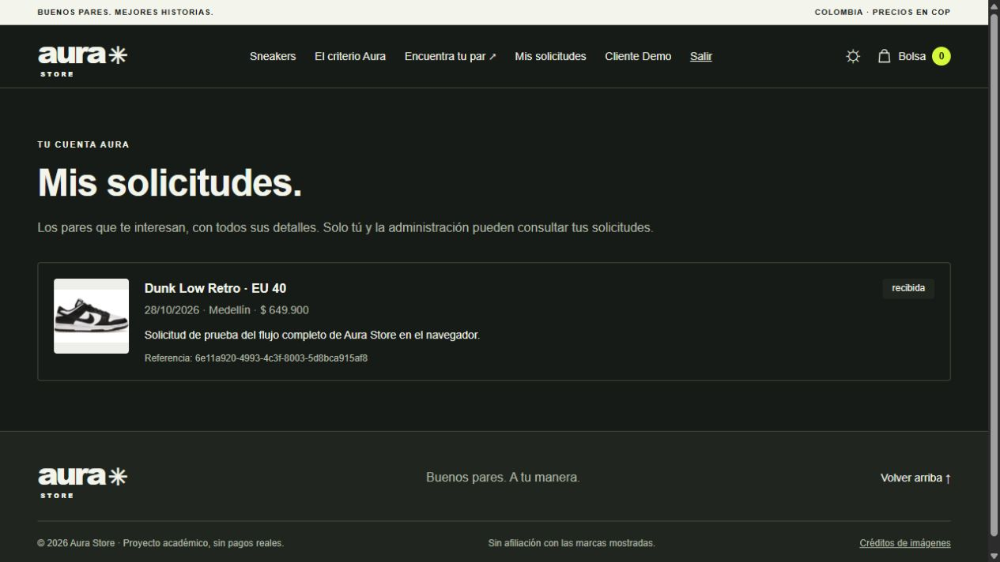

# Aura Store: informe para la sustentación

**Autor del proyecto:** Santiago Alcaraz. **Curso:** Desarrollo Web 2026-2. **Entrega 3.**

Este documento describe el trabajo implementado y la evidencia disponible. No reemplaza la demostración ni atribuye al estudiante experiencias que no haya expresado. Estado de cierre: frontend Next publicado en Vercel y catálogo conectado a Render. Login admin comprobado en producción. La sección de pendientes distingue lo que todavía falta verificar.

## 1. Qué cambió

Aura Store continúa siendo la tienda de sneakers de la primera entrega. Conserva su nombre, enfoque, seis modelos originales, cinco marcas, tres categorías, fotografías, descripciones y precios en pesos colombianos. El cambio principal está en lo que sucede detrás de la pantalla: el catálogo se consulta a un servidor y las solicitudes se guardan de verdad, vinculadas a una cuenta.

Antes, la página trabajaba con archivos HTML, CSS y JavaScript y un catálogo incluido en esos archivos. El formulario era una demostración de captura y validación. Ahora existen dos aplicaciones relacionadas: la tienda que usa el visitante y la API que comprueba las operaciones y consulta PostgreSQL. Cada aplicación tiene su repositorio, como exige la consigna.

La primera entrega se conserva en `legacy/entrega-1/` y su README en `docs/ENTREGA-1-README.md`. Así se puede comparar el punto de partida sin confundir esos archivos históricos con la aplicación Next actual.

## 2. Qué puede hacer cada persona

**Visitante:** puede recorrer el catálogo sin crear una cuenta, buscar un modelo, combinar filtros de marca, categoría y precio, cambiar de página y consultar tallas. La dirección de la página conserva la paginación. También puede usar la bolsa y cambiar el tema visual. La bolsa conserva referencias en el navegador; no representa una compra cobrada.

**Usuario registrado:** puede iniciar sesión, refrescar la página y continuar identificado. La navegación muestra su nombre y la opción de salir. Puede enviar una solicitud sobre un modelo y talla, y revisar su historial en Mis solicitudes. La solicitud queda asociada a su identidad comprobada por el servidor. El formulario no decide quién es el dueño.

**Administrador:** además de lo anterior, dispone de Administración para crear productos, editar información, organizar tallas y existencias, y consultar todas las solicitudes. El borrado presenta una confirmación. Si un producto tiene solicitudes asociadas, el sistema rechaza su eliminación para conservar el historial.

El proyecto registra solicitudes de interés. No tiene pasarela de pago, no descuenta inventario al solicitar y no confirma una reserva comercial. Tampoco se implementó subida de archivos: el editor recibe una ruta o URL de imagen.

## 3. Cómo se hizo y por qué

La interfaz se reconstruyó con componentes Next.js y Tailwind conservando la identidad de Aura. Se separaron las partes de acceso, productos, solicitudes y elementos comunes. Esto permite ajustar un formulario sin concentrar toda la aplicación en una sola página.

La API se organizó en cuatro capas. En términos sencillos, una parte define los datos y reglas; otra coordina acciones como registrar una solicitud; otra conecta con la base y las herramientas de seguridad; y otra recibe las peticiones de Internet. Esta separación ayuda a revisar quién puede hacer cada operación y dónde se produce un error.

Se preparó una carga inicial con los productos reales de la primera entrega. No se inventó un catálogo diferente para la migración. La base relaciona cada solicitud con un usuario y un producto, evitando solicitudes sin dueño o sin un producto válido.

Todas las peticiones del frontend pasan por un cliente común. Ese cliente adjunta la sesión y trata los errores de forma consistente. Cuando el servidor no responde, el sitio informa el problema: no presenta un catálogo ficticio como si la conexión hubiera funcionado.

## 4. Cómo se guardan y protegen los datos

PostgreSQL guarda usuarios, marcas, categorías, productos, tallas y solicitudes. Las contraseñas se transforman con bcrypt antes de guardarlas. La aplicación compara esa transformación al entrar y no devuelve contraseñas en las respuestas.

Después del login, la API entrega un token firmado con identificación, rol y vencimiento. Puede entenderse como una credencial temporal: no contiene la contraseña y el servidor comprueba que no haya sido alterada. El navegador lo envía en el encabezado Authorization cuando necesita una operación protegida.

El token se conserva en una cookie para mantener la sesión al refrescar. Esa cookie es accesible a JavaScript, por lo que un ataque que ejecutara código malicioso en la página podría robarla. No se afirma que sea HttpOnly. En HTTPS utiliza Secure y tiene SameSite=Lax. La API vuelve a verificar identidad y permisos aunque alguien manipule la interfaz.

Un error **401** significa que falta una credencial válida: por ejemplo, intentar borrar un producto sin token. Un **403** significa que la persona sí inició sesión, pero su rol no tiene permiso: por ejemplo, un usuario común intentando borrar un sneaker. Un correo repetido produce **409**, los datos inválidos **400** y un recurso inexistente **404**.

Las claves privadas y la conexión de la base se configuran fuera de Git. Vercel conserva la dirección pública de la API y una clave privada de servidor para comprobar las rutas protegidas. Render mantiene la API y PostgreSQL. CORS permite el dominio concreto de Aura en Vercel.

## 5. Comprobaciones y correcciones reales

Se ejecutaron pruebas automáticas de autenticación, roles y operaciones contra PostgreSQL local. Se obtuvieron 11 resultados correctos. GitHub también ejecutó la verificación con una base temporal y terminó correctamente: [ejecución CI](https://github.com/SantiagoAlcaraz1101/aura-store-api/actions/runs/40808114436).

En el navegador local se comprobó catálogo paginado, login, permanencia de sesión al refrescar, solicitud guardada y visible en Mis solicitudes, redirección de un usuario común fuera de Administración y redirección al login después de salir. Se creó y editó un producto temporal desde el panel; el precio actualizado apareció en la lista. Se abrió su confirmación de borrado, pero ese paso no se registra como eliminación completada.

Se corrigió la selección de marca y categoría al editar: las opciones llegan después desde la API y debían conservar la selección inicial. También se ajustó el límite de contraseña por bytes, coherente con bcrypt, y una dependencia con vulnerabilidad reportada. La compilación final de Next y su comprobación TypeScript finalizaron correctamente el 29 de octubre.

En producción se verificó respuesta 200 del catálogo de Render, total de seis productos y encabezado CORS para `https://aura-store-azure.vercel.app`. Esto comprueba la API pública; no equivale a aprobar todas las pruebas del frontend publicado.

La captura anterior es local. **La captura auténtica de Network con Authorization sigue pendiente**, así como la comprobación completa de las nueve secuencias del profesor en producción. No se reemplaza esa evidencia por una captura de consola ni por una imagen construida.

## 6. Recorrido sugerido para la presentación

1. Abrir Aura sin sesión y explicar qué se conservó de la primera entrega. Mostrar filtros y página 2.
2. Registrar una cuenta con datos de prueba. Salir e intentar registrar el mismo correo para mostrar el error junto al campo.
3. Iniciar sesión y refrescar para demostrar que se conserva. Enviar una solicitud y abrir Mis solicitudes.
4. Escribir `/admin` con la cuenta común y mostrar la redirección. Explicar que la API también rechaza operaciones de administrador.
5. Entrar con la cuenta admin y crear un producto temporal identificable. Editar su precio y comprobar el cambio. Eliminar solo ese producto de demostración, confirmando la acción.
6. Mostrar en Network una petición protegida y su encabezado Authorization. No mostrar claves privadas de Render o Vercel.
7. Cerrar sesión y volver a una ruta privada. Terminar mostrando los dos repositorios y los enlaces públicos.

Estas son instrucciones de demostración, no una afirmación de que todos los pasos ya se hayan ejecutado en producción.

## 7. Posibles preguntas del docente

**¿Por qué sigue siendo el mismo proyecto?** Conserva el dominio de sneakers, identidad, contenido y catálogo originales. Cambió su funcionamiento interno para usar cuentas, API y persistencia.

**¿Cómo se demuestra que una solicitud se guarda?** Se envía con sesión y se consulta después en Mis solicitudes. La API la recupera de PostgreSQL usando la identidad del token.

**¿Puedo cambiar el dueño desde el formulario?** No. El dueño se obtiene del token validado; la API no confía en un identificador de usuario enviado en el cuerpo.

**¿Ocultar Administración protege los datos?** No basta. La API verifica el rol antes de permitir creación, edición, borrado y consulta general.

**¿Por qué no se puede borrar un producto con solicitudes?** Para mantener la relación y el historial de las solicitudes existentes.

**¿Dónde está el token y cuál es su riesgo?** En una cookie accesible a JavaScript; un XSS podría leerlo. Esa limitación está documentada y no debe confundirse con una cookie HttpOnly.

**¿Qué sucede si falla la API?** Se muestra un estado de error y posibilidad de reintentar. El catálogo no se sustituye con datos locales.

**¿Qué hizo la IA?** Codex apoyó implementación, migración, pruebas, configuración y documentación. Las correcciones concretas se explican arriba. El estudiante debe revisar el código y ensayar la demostración; este informe no inventa una experiencia personal de desarrollo.

## 8. Enlaces y pendientes de cierre

- [Repositorio frontend](https://github.com/SantiagoAlcaraz1101/aura-store).
- [Repositorio backend](https://github.com/SantiagoAlcaraz1101/aura-store-api).
- [Frontend Vercel](https://aura-store-azure.vercel.app/): versión Next publicada automáticamente desde main, commit dd3a543.
- [API Render](https://aura-store-api.onrender.com/health): salud y catálogo verificados públicamente.

Falta comprobar los nueve flujos completos en producción, completar la captura Network en ambos README y confirmar el despliegue automático de Render desde GitHub. Se mantiene el historial real; los commits no representan tiempos de trabajo inventados. Por petición urgente del usuario, los nuevos commits se publican de inmediato. Moodle y correo quedan a cargo del estudiante.
